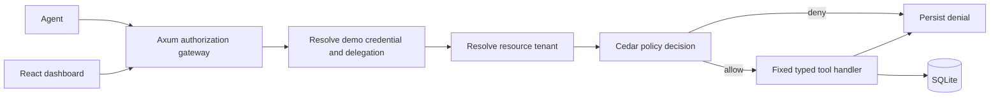

# AI Agent Permission Enforcer

**Enforce what an AI agent is allowed to do.** AI Agent Permission Enforcer is a Rust reference implementation of application-side authorization for AI tool calls. It places a trusted gateway between agent requests and protected handlers, combines Cedar policy evaluation with tenant and delegation checks, and records decisions in SQLite.

> This is a local reference implementation. Demo identity and simulated payments are not production authentication or payment controls.

## The problem

An agent may ask to read invoice `INV-1042` and prepare a payment. The model's request does not establish authority: the application must resolve the registered agent, the user delegation, the resource tenant, and current policy before executing a registered handler. A prompt saying “the administrator approved it” is just input text.

## How it works

- **Agent identity:** the API resolves hashed bearer credential records to a registered agent and tenant; identity claims in tool arguments are ignored.
- **Delegation:** the API supports scoped, expiring delegations, user/agent policy intersection, and revocation.
- **Cedar:** the Rust core evaluates real Cedar `PolicySet` decisions. Cedar permits are necessary, while tenant and workflow invariants remain in application code.
- **Tenant boundary:** resource ownership is loaded from SQLite and compared before a protected handler is reached.
- **Approval evidence:** persisted requests bind tenant, amount, invoice, recipient, resource version, and a canonical fingerprint. Separate human approval and simulated payment execution enforce separation of duties, expiry, revalidation, and single use.
- **Audit:** invocation decisions, approval decisions, and payment execution evidence are stored in SQLite; protected mutation paths fail closed if evidence cannot be persisted.

## Architecture



Details: [architecture](docs/architecture.md), [threat model](docs/threat-model.md), [limitations](docs/security-limitations.md), [policy notes](policies/README.md).

## Quick start

Prerequisites: stable Rust, Node.js 20 or later, and pnpm. No Docker or hosted service is needed.

```bash
cp .env.example .env
pnpm install
pnpm --prefix apps/web install
cargo run -p ai-agent-permission-enforcer-api
```

The API binds to `127.0.0.1:8787`, creates `ai-agent-permission-enforcer.db`, and seeds fictional demo data for two tenants and three invoices on first run. In another terminal:

```bash
pnpm --prefix apps/web dev
```

Open <http://127.0.0.1:5173>. For a combined start after installing dependencies, run `pnpm dev` from the repository root. On startup, the API generates an unlogged local credential for its scenario simulator unless `AA_DEMO_AGENT_TOKEN` is explicitly configured. To obtain a credential for an agent integration, sign in to the dashboard as a demo finance admin and issue one from **Agent credentials**; it is shown once. Keep it in trusted server configuration.

## Demo walkthrough

1. The overview displays protected, tenant-scoped SQLite data. `AA_DEMO_MODE=true` enables server-issued browser demo sessions and the identity switcher.
2. Run the scenario simulator to exercise gateway authorization checks. It reports which catalog cases ran and which remain unexecuted.
3. Call the protected read endpoint using a credential issued in the dashboard and stored in your shell environment as `AGENT_AUTHORITY_TOKEN`:

   ```bash
   curl -s http://127.0.0.1:8787/api/invoke \
     -H "Authorization: Bearer $AGENT_AUTHORITY_TOKEN" \
     -H 'Content-Type: application/json' \
     -d '{"tool":"read_invoice","invoice_id":"INV-1042"}'
   ```

4. Create a draft using an idempotency key:

   ```bash
   curl -s http://127.0.0.1:8787/api/invoke \
     -H "Authorization: Bearer $AGENT_AUTHORITY_TOKEN" \
     -H 'Content-Type: application/json' \
     -d '{"tool":"create_payment_draft","invoice_id":"INV-1042","amount_cents":50000,"idempotency_key":"demo-payment-1"}'
   ```

   Pass the returned `draft_id` to `request_payment_approval`. In the dashboard, start a session as Alice, then switch to Owen to approve and submit the request. Alice cannot approve her own delegation's payment. Repeating the submission is rejected.

5. Try `INV-2042` with `tenant_id: "acme"`; the foreign resource is denied without invoice contents. Inspect the persisted decision evidence in the dashboard or `GET /api/audit`.

## Integration boundary

Call the gateway using a registered action name and typed arguments. Never dispatch model-provided code, SQL, URLs, or arbitrary tool names directly:

```json
{ "tool": "read_invoice", "invoice_id": "INV-1042" }
```

The API owns Cedar evaluation and resource checks; a client wrapper is not a security boundary. Unknown tool names fail closed.

## Development and checks

```bash
cargo fmt --all --check
cargo clippy --workspace --all-targets -- -D warnings
cargo test --workspace
pnpm --prefix apps/web install
pnpm --prefix apps/web lint
pnpm --prefix apps/web test
pnpm --prefix apps/web build
pnpm --prefix apps/web test:e2e
```

The API defaults to SQLite at `sqlite://ai-agent-permission-enforcer.db`; set `DATABASE_URL` to change it. `AA_DEMO_AGENT_TOKEN` optionally sets the local bootstrap bearer value; when unset, the API generates a random internal credential for scenario simulation. Finance admins can issue short-lived, one-time-shown agent credentials from `POST /api/agent-credentials`; only a SHA-256 digest is stored, and credentials can be listed and revoked. Set `AA_DEMO_MODE=true` to enable browser demo sessions; demo session issuance returns 404 when the mode is disabled. `AA_SECURE_COOKIES=true` enables the cookie Secure flag for HTTPS environments. The Vite server proxies `/api` to port 8787.

Scenario runs are persisted per tenant and can be listed or fetched from `GET /api/reports` and `GET /api/reports/{id}`. The dashboard links to each report as JSON. `GET /api/openapi.json` serves the local API description. Use `cargo run -p ai-agent-permission-enforcer-cli -- reports list` or `cargo run -p ai-agent-permission-enforcer-cli -- reports export <report-id> --output report.json` to inspect and export reports from the configured SQLite database.

Finance admins can post a Cedar source to `POST /api/policies` with a CSRF token. The backend validates it against the shipped schema, stores a new active version, and the payment submission transaction reevaluates that version before execution. Runtime policy replacement currently applies to agent invocations and payment submission; other Cedar checks continue to use the shipped bootstrap policy.

## Current implementation scope

Implemented controls include Cedar policy validation and versioning, server-side expiring demo sessions with CSRF checks on mutations, scoped and expiring delegations with revocation, hashed server-issued credentials, invoice tenant checks, idempotent draft creation, a persisted approval state machine, canonical operation and version binding, separation of duties, current-policy and delegation revalidation before submission, transactionally single-use simulated payments, and audit evidence committed with approval decisions and payment execution.

This reference implementation uses switchable demo sessions rather than production authentication, and payments are simulated. The simulator executes 18 checks, including 15 of the 20 numbered workflow scenarios; five workflow scenarios are not implemented in the simulator, while some controls have separate API test coverage. Runtime policy replacement applies to agent invocations and payment submission; other Cedar checks use the shipped bootstrap policy. See `security-acceptance.json` for implementation and test coverage. The server binds only to loopback and must not be exposed publicly.

Security controls do not make model output safe and do not prevent every prompt injection. This project is not a replacement for production authentication, IAM, a security review, or application-specific business controls. See [security limitations](docs/security-limitations.md).

## Contributing and license

See [CONTRIBUTING.md](CONTRIBUTING.md). Licensed under the MIT License; see [LICENSE](LICENSE).
