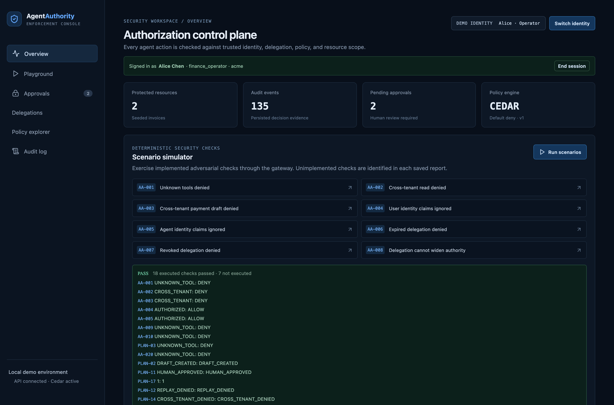
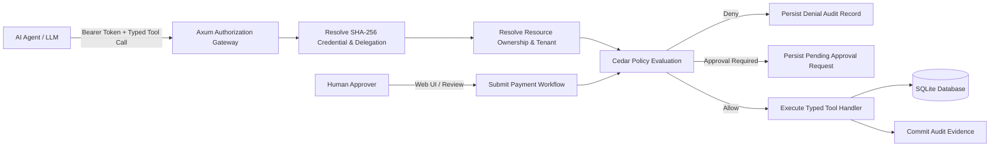
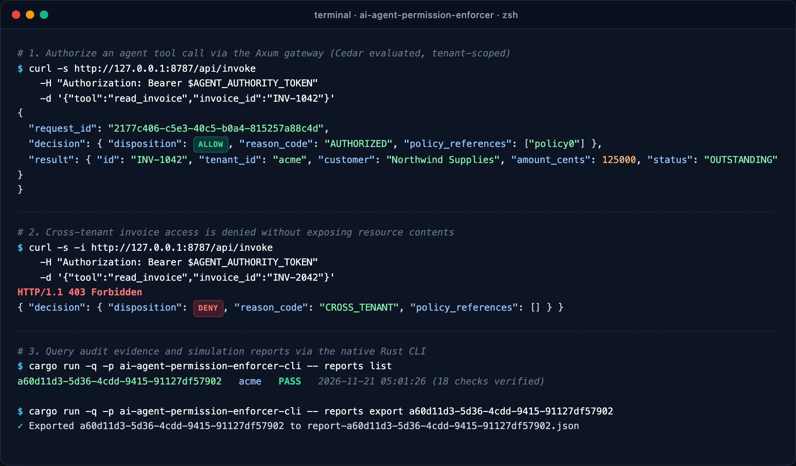
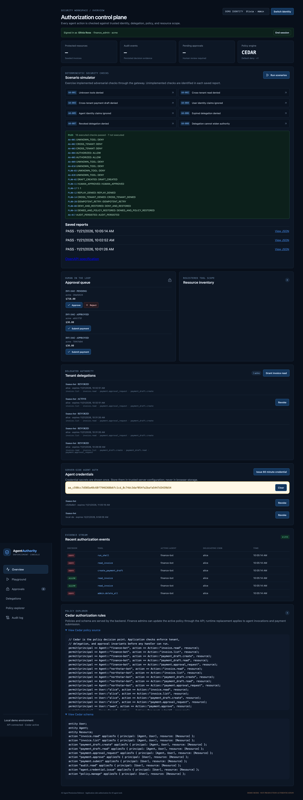
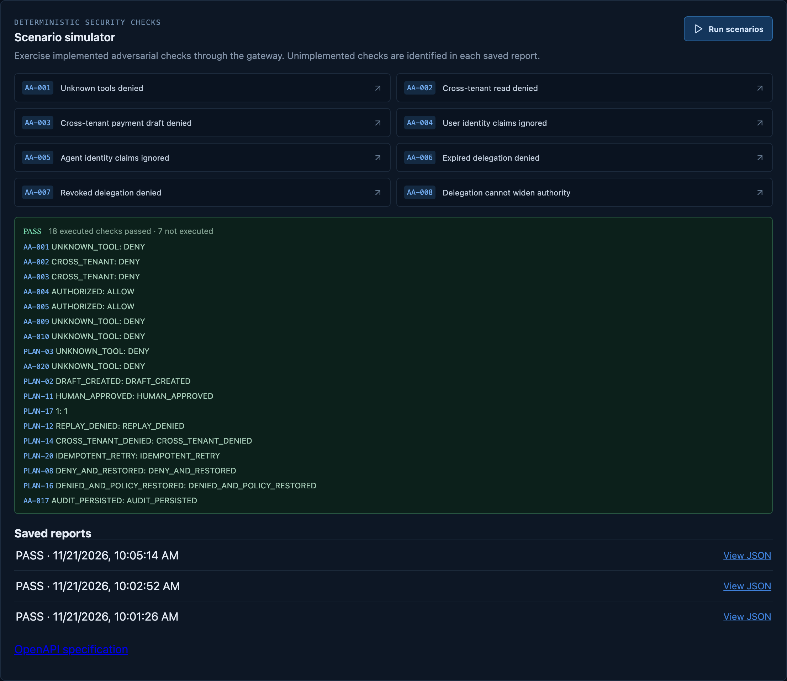
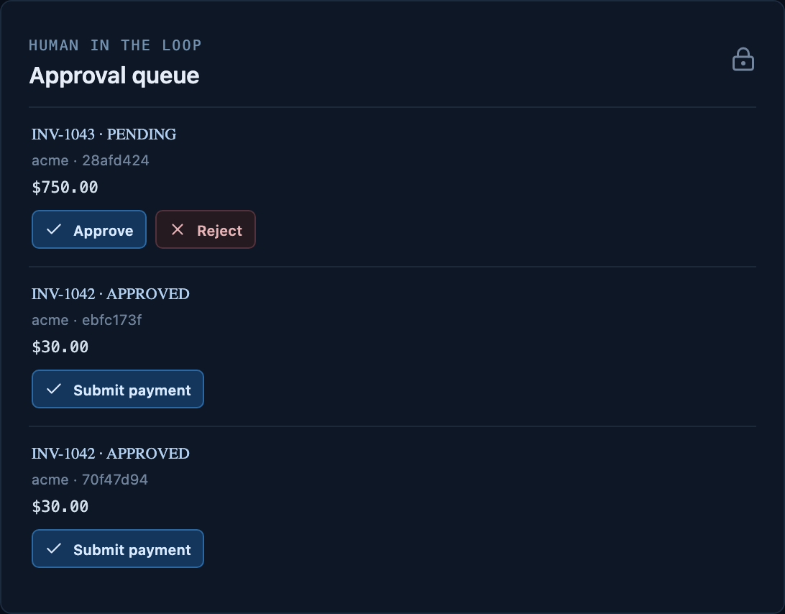
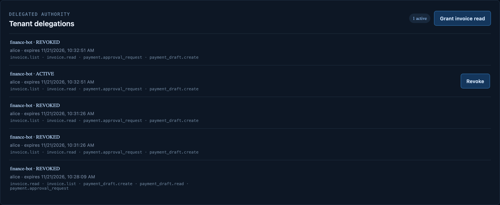
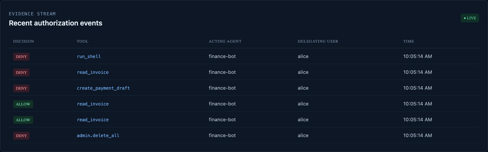
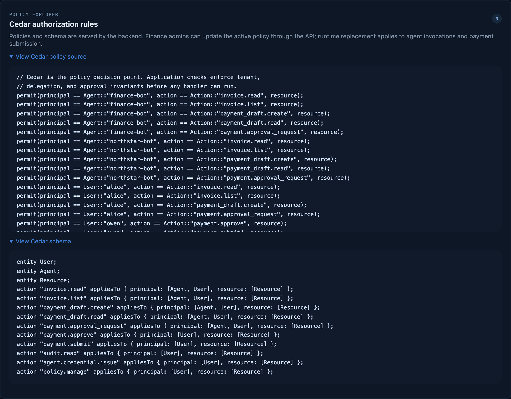

# AI Agent Permission Enforcer

**Application-side authorization gateway and policy enforcement for AI tool calls.**

AI Agent Permission Enforcer is a high-performance Rust reference implementation of application-side authorization for AI agent tool execution. It places an unbypassable, trusted authorization gateway between AI model tool requests and backend business handlers, pairing **AWS Cedar policy evaluation** with cryptographic credential resolution, strict tenant isolation, human-in-the-loop approval state machines, and immutable SQLite audit persistence.

[](#testing-and-verification)
[](#testing-and-verification)
[](https://www.cedarpolicy.com/)
[](LICENSE)

---



> **Reference Implementation Notice:** This repository provides an executable local reference architecture and security verification testbed. Demo sessions and simulated payment handlers demonstrate authorization invariants; they are not intended as production identity providers or banking connectors.

---

## The Problem

When an autonomous AI agent or LLM issues a tool call (such as reading an invoice `INV-1042` or triggering a financial payout), **the model's request does not establish authority**.

A model prompt declaring _"The administrator approved this payment"_ or supplying a forged `tenant_id: "acme"` argument is simply untrusted user input. Giving an agent direct access to backend APIs or databases creates critical vulnerabilities:

- **Prompt Injection & Confusion:** Attackers can trick models into invoking privileged tools outside their allowed scope.
- **Cross-Tenant Data Leakage:** Argument-based tenant filters can be bypassed if the enforcement layer does not independently resolve resource ownership.
- **Authority Escalation:** Delegations must not expand beyond what the human delegator is authorized to perform.
- **Unchecked Critical Mutations:** High-value mutations (e.g., fund transfers) require cryptographic operation binding, separation of duties, and human approvals before execution.

---

## How It Works



1. **Hashed Server-Issued Credentials:** The gateway resolves bearer tokens against SHA-256 digests in SQLite to identify the registered agent and tenant. Identity claims in tool call payloads are ignored.
2. **Scoped, Expiring Delegations:** Human users delegate authority to agents with explicit action whitelists (`invoice.read`, `payment_draft.create`) and expiration timestamps. Delegations can be revoked instantly.
3. **Formal Cedar Policy Decision Point (PDP):** Evaluates Amazon Cedar `PolicySet` rules against typed principal, action, and resource entities. Default-deny is enforced globally.
4. **Tenant Boundary Enforcement:** Resource ownership is queried from persistent storage and verified before reaching any tool handler. Cross-tenant access fails closed with zero data leakage.
5. **Human Approval State Machine:** Financial drafts bind the tenant, invoice ID, recipient, amount, and canonical hash. Approvals enforce separation of duties: the delegating operator cannot approve their own agent's payout.
6. **Immutable Audit Trail:** Invocations, approvals, and mutations fail closed if audit records cannot be persisted to SQLite.

---

## Interactive Terminal Verification

The repository includes both an Axum HTTP API gateway and a native Rust management CLI (`ai-agent-permission-enforcer-cli`):



---

## Feature Showcase

### 1. Authorization Control Plane & Live Dashboard

The React + Vite dashboard (`apps/web`) provides a real-time command center for security operators, approvers, and administrators. It visualizes protected resources, audit event velocity, pending human approvals, and Cedar engine health.



### 2. Automated Attack Scenario Simulator

An integrated security test harness tests 18 deterministic attack vectors against the running gateway—including unknown tool calls, cross-tenant reads, prompt-injected identity claims, and delegation tampering. Each run generates a signed report with full JSON export.



### 3. Human-in-the-Loop Approval Queue

Critical financial mutations trigger an `APPROVAL_REQUIRED` disposition. High-value drafts enter a persisted approval queue where authorized reviewers can inspect details and execute or reject payments with separation of duties.



### 4. Scoped Delegations & Revocation

Grant fine-grained, time-bounded tool access to specific agents. The engine verifies delegation validity at both draft creation time and payment execution time; revoking a delegation immediately invalidates downstream execution.



### 5. Authorization Audit Trail

Every gateway invocation is recorded with cryptographic request IDs, decision dispositions (`ALLOW`, `DENY`, `APPROVAL_REQUIRED`), normalized tool names, acting agents, delegating users, and Cedar policy references.



### 6. Cedar Policy & Schema Explorer

View live AWS Cedar rules and schemas served directly by the backend. Finance administrators can inspect policy sets and update active policies dynamically with CSRF protection.



---

## Quick Start

### Prerequisites

- **Rust:** Stable toolchain (`rustc` & `cargo` 1.80+)
- **Node.js:** v20.0 or higher
- **pnpm:** v9 or v10

### 1. Clone & Setup Environment

```bash
git clone https://github.com/ranajahanzaib/ai-agent-permission-enforcer.git
cd ai-agent-permission-enforcer
cp .env.example .env
```

### 2. Install Dependencies

```bash
pnpm install
pnpm --prefix apps/web install
```

### 3. Start the API Gateway

```bash
cargo run -p ai-agent-permission-enforcer-api
```

> **macOS Note:** If building on macOS with standalone Command Line Tools, ensure `DEVELOPER_DIR=/Library/Developer/CommandLineTools` is set if required by your Xcode linker configuration.

The API gateway binds to `http://127.0.0.1:8787`, seeds fictional demo data for two tenants (`acme` and `northstar`), and creates the local SQLite database (`ai-agent-permission-enforcer.db`).

### 4. Start the Web Dashboard

In a separate terminal:

```bash
pnpm --prefix apps/web dev
```

Open [http://127.0.0.1:5173](http://127.0.0.1:5173) in your browser. Alternatively, run `pnpm dev` from the repository root to launch both concurrently.

---

## Step-by-Step Walkthrough

### 1. Authorize an Agent Tool Call

Call the gateway using a registered tool name and valid bearer token:

```bash
curl -s http://127.0.0.1:8787/api/invoke \
  -H "Authorization: Bearer $AGENT_AUTHORITY_TOKEN" \
  -H "Content-Type: application/json" \
  -d '{"tool":"read_invoice","invoice_id":"INV-1042"}'
```

**Response (200 OK):**

```json
{
  "request_id": "2177c406-c5e3-40c5-b0a4-815257a88c4d",
  "decision": {
    "disposition": "ALLOW",
    "reason_code": "AUTHORIZED",
    "policy_references": ["policy0"]
  },
  "result": {
    "id": "INV-1042",
    "tenant_id": "acme",
    "customer": "Northwind Supplies",
    "amount_cents": 125000,
    "status": "OUTSTANDING"
  }
}
```

### 2. Verify Cross-Tenant Denial

Attempt to read invoice `INV-2042` (which belongs to tenant `northstar`) using an `acme` agent credential:

```bash
curl -s -i http://127.0.0.1:8787/api/invoke \
  -H "Authorization: Bearer $AGENT_AUTHORITY_TOKEN" \
  -H "Content-Type: application/json" \
  -d '{"tool":"read_invoice","invoice_id":"INV-2042"}'
```

**Response (403 Forbidden):**

```json
{
  "request_id": "6bcd20ed-3311-4b58-ab6d-df7976ca8976",
  "decision": {
    "disposition": "DENY",
    "reason_code": "CROSS_TENANT",
    "policy_references": []
  }
}
```

_The request is blocked at the gateway with zero resource data leaked._

### 3. Create a Payment Draft & Request Approval

```bash
# Step A: Create idempotent draft
curl -s http://127.0.0.1:8787/api/invoke \
  -H "Authorization: Bearer $AGENT_AUTHORITY_TOKEN" \
  -H "Content-Type: application/json" \
  -d '{"tool":"create_payment_draft","invoice_id":"INV-1042","amount_cents":50000,"idempotency_key":"payout-001"}'

# Step B: Request human approval using draft_id
curl -s http://127.0.0.1:8787/api/invoke \
  -H "Authorization: Bearer $AGENT_AUTHORITY_TOKEN" \
  -H "Content-Type: application/json" \
  -d '{"tool":"request_payment_approval","draft_id":"<draft_id>"}'
```

**Response (202 Accepted):**

```json
{
  "decision": {
    "disposition": "APPROVAL_REQUIRED",
    "reason_code": "HUMAN_APPROVAL_REQUIRED",
    "policy_references": ["policy4"]
  },
  "result": {
    "approval_id": "266bd577-2738-4705-ba38-f120acf0cc8c",
    "status": "PENDING",
    "expires_in_seconds": 600
  }
}
```

---

## Native CLI Tool

The repository provides `ai-agent-permission-enforcer-cli` to inspect and export simulation reports directly from the SQLite database:

```bash
# List all simulation runs and verdicts
cargo run -p ai-agent-permission-enforcer-cli -- reports list

# Export a full audit report to JSON
cargo run -p ai-agent-permission-enforcer-cli -- reports export <report-id> --output report.json
```

---

## TypeScript Client Integration

A server-side client adapter is provided in [`packages/ai-agent-permission-enforcer-client`](packages/ai-agent-permission-enforcer-client):

```ts
import { AgentPermissionEnforcerClient } from "@ai-agent-permission-enforcer/client";

const authority = new AgentPermissionEnforcerClient({
  baseUrl: process.env.AGENT_AUTHORITY_URL ?? "http://127.0.0.1:8787",
  bearerToken: process.env.AGENT_AUTHORITY_TOKEN!,
});

// Wrap tool calls within your agent handler
const outcome = await authority.invoke({
  tool: "read_invoice",
  invoice_id: "INV-1042",
});

if (outcome.decision?.disposition !== "ALLOW") {
  throw new Error(`Permission denied: ${outcome.decision?.reason_code}`);
}

return outcome.result;
```

---

## Repository Structure

```text
├── apps/
│   └── web/                               # React + Vite admin and simulation dashboard
│       ├── e2e/                           # Playwright end-to-end test suite
│       └── src/                           # Dashboard UI and query components
├── crates/
│   ├── ai-agent-permission-enforcer-api/  # Axum HTTP authorization gateway
│   ├── ai-agent-permission-enforcer-cli/  # Command-line reporting utility
│   └── ai-agent-permission-enforcer-core/ # Cedar PDP evaluation & domain logic
├── docs/
│   ├── architecture.md                    # In-depth system design & sequence flow
│   ├── integration-example.md             # Agent runtime and MCP adapter patterns
│   ├── security-limitations.md            # Threat boundary & out-of-scope risks
│   ├── threat-model.md                    # Attack tree & STRIDE analysis
│   └── screenshots/                       # High-resolution showcase assets
├── migrations/                            # SQLite schema migrations
├── packages/
│   └── ai-agent-permission-enforcer-client/ # Type-safe TypeScript client SDK
└── policies/
    ├── finance.cedar                      # AWS Cedar authorization policy set
    └── schema.cedarschema                 # Cedar entity and action schema
```

---

## Testing and Verification

Every layer of the project includes automated test coverage:

```bash
# 1. Run all Rust unit and integration tests (18 tests)
cargo test --workspace

# 2. Run Rust static analysis and linting
cargo clippy --workspace --all-targets -- -D warnings
cargo fmt --all --check

# 3. Run frontend unit tests (Vitest)
pnpm --prefix apps/web test

# 4. Run frontend type check
pnpm --prefix apps/web lint

# 5. Run full end-to-end browser tests (Playwright)
pnpm --prefix apps/web test:e2e
```

### Verification Matrix

| Component           | Test Suite                                           | Pass Count | Status   |
| ------------------- | ---------------------------------------------------- | ---------- | -------- |
| **Cedar Core**      | `ai-agent-permission-enforcer-core` unit tests       | 8 passed   | Verified |
| **Gateway API**     | `ai-agent-permission-enforcer-api` integration tests | 10 passed  | Verified |
| **Web UI**          | Vitest unit tests                                    | 2 passed   | Verified |
| **End-to-End**      | Playwright browser automation tests                  | 2 passed   | Verified |
| **Static Analysis** | Clippy & TypeScript Compiler                         | 0 errors   | Verified |

---

## Threat Model & Security Boundaries

- **Input Invalidation:** The gateway ignores arbitrary user prompts, system instructions, and caller-supplied identity claims. Authority is established strictly via cryptographic bearer tokens.
- **Fail Closed:** Unknown tools, missing bearer headers, unresolvable tenants, or persistence errors trigger immediate denials (`HTTP 403` or `500`).
- **Separation of Duties:** Operators who configure delegations cannot self-approve payout drafts.
- **Single-Use Payments:** Once an approved payment draft is executed, its authorization token is marked `CONSUMED` transactionally. Replay submissions return `HTTP 409 Conflict`.
- **Reference Scope:** For detailed threat analysis, see [docs/threat-model.md](docs/threat-model.md) and [docs/security-limitations.md](docs/security-limitations.md).

---

## Contributing

Contributions are welcome! Please read [CONTRIBUTING.md](CONTRIBUTING.md) and our [CODE_OF_CONDUCT.md](CODE_OF_CONDUCT.md) before submitting pull requests.

## License & Custom Work

[](mailto:work@withrana.com) [](https://www.linkedin.com/in/workwithrana)
[](https://www.upwork.com/freelancers/~01bbcf6edb91a8df5f)
[](https://contra.com/ranajahanzaib/)

**License:** MIT. Free for personal and commercial use.

**Author:** Rana Jahanzaib

**Need this built for your stack?** Email me what you're working on: work@withrana.com
