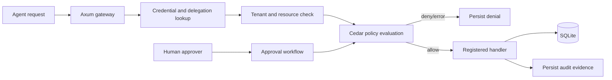

# Architecture

The Rust API is the trusted boundary. It accepts a registered tool identifier, resolves a hashed credential record to its registered agent and tenant, validates delegation state and resource ownership, asks Cedar for a policy decision, writes invocation evidence, and only then reaches a fixed handler. The React application is a viewer and simulator; browser visibility is not an authorization mechanism.

Current app is an executable reference slice, not a production-ready authentication service. See [security limitations](security-limitations.md).
